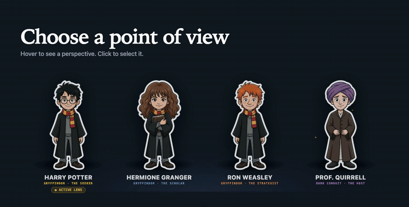
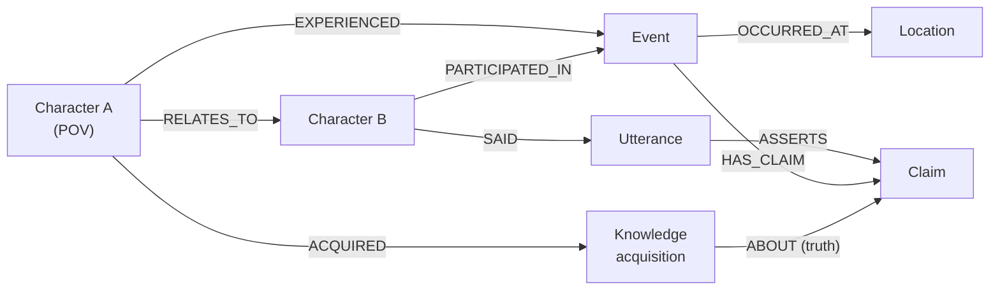
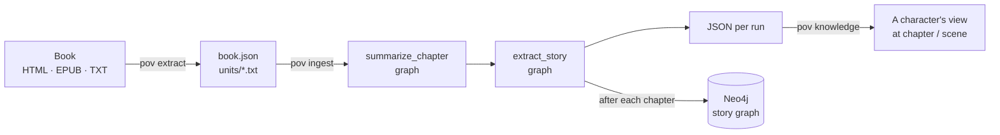

# POV Graph

**Retell a story from one character's point of view, using only what that character knows at that moment.**

`pov-retell` is a Python CLI that turns a novel into structured, chapter-by-chapter data about its
characters, relationships, places and scenes. That data is the base for a POV graph: a graph that
separates *what happened* in a story from *what each character knows* about it.

<p align="center">
  
</p>

> 🎞️ The project pitch is an interactive slide deck:
> [`doc/presentation/pov-graph-slides.html`](doc/presentation/pov-graph-slides.html)
> (open it in a browser; **Next/Space/→** to advance, **N** for speaker notes).
> The 5-minute talk track is in
> [`doc/presentation/presentation-script-5min.md`](doc/presentation/presentation-script-5min.md).

---

## Why

Characters share a story, but they do not share the same knowledge.

Take Harry in *Harry Potter and the Philosopher's Stone*. Before the final chapter he is sure that
Snape is trying to steal the Stone. He has clues, and he reads all of them wrongly:

| Before the reveal (up to Chapter 16) | What Harry learns in Chapter 17 |
| --- | --- |
| He sees Snape's injured leg after Halloween. | Quirrell's harmless manner was an act. |
| Hermione sees Snape muttering during the Quidditch match. | Snape was protecting Harry during that match. |
| He overhears Snape confronting Quirrell in the forest. | Voldemort was hiding in Quirrell's body. |

A retelling of an earlier chapter from Harry's point of view must keep that suspicion. An AI that has
already read the ending can easily spoil it. So the project's rule is:

> **Model what characters know, not just where they were.**

## The POV graph

The graph has four layers. Each layer adds one kind of fact about the story.



| Layer | Nodes | What it records |
| --- | --- | --- |
| 1 · People | `Character` | Who exists, their names, aliases and relationships. |
| 2 · What happened | `Event`, `Location` | What happened, who took part, where, and in what order. |
| 3 · What was said | `Utterance`, `Claim` | What someone said, kept apart from whether it is true. |
| 4 · What was learned | `KnowledgeAcquisition` | How and when a character got a claim, and what they believe about it (see the seven channels below). |

Hearing something, seeing something, and knowing it are different. Layer 4 lets a narrator
receive only the knowledge that the chosen character has *at the chosen point in the story*.

A character can get a claim through seven **channels**: `prior` (knew it before the story),
`witnessed`, `told`, `read`, `overheard`, `inferred`, and `learns_truth` (finds out it is true or
false). Each acquisition also has a **stance**: `believes`, `doubts` or `disbelieves`. A `Claim`
node stores the book's truth; what a character knows comes only from their acquisitions.

> **Status:** all four layers are extracted chapter by chapter and written to Neo4j, and
> `pov knowledge` shows a character's view at any point. Verified offline and against a local
> Neo4j; not yet run on a real book with a live model. See [Roadmap](#roadmap).

## What we learned building it

### Sprint 1 — Design the graph

Separate the story's facts from each character's view of them, as shown above.

### Sprint 2 — One prompt for everything did not work

The first approach sent a whole chapter (around 6,000 words) and asked for people, feelings,
relationships and scenes in one large answer. It:

- **invented connections** between people who were never in the same room;
- **missed less prominent characters** (Neville, Madam Hooch, Fluffy);
- **failed as a whole** when one answer was cut off or returned broken JSON;
- and made it impossible to tell **which** of the tasks had gone wrong.

The fix: **give each step one job, and check its answer before continuing.** LangGraph runs the
steps in order, Pydantic and Python checks validate each answer, and a rejected answer is retried
with the exact error. Correct formatting still does not prove a story fact is correct, so original
chapter text stays the evidence and every record stays a *candidate*.

### Sprint 3 — Harry does not know yet

An AI that knows the ending can spoil an earlier scene. The design uses two readings with
different jobs:

1. **Story facts (WHO IS WHO):** read the whole book to connect names and identities, including
   those revealed near the end (Quirrell is hiding Voldemort; Snape was protecting Harry).
2. **The character's view (WHEN THEY LEARN IT):** walk the chapters in order and record what the
   character believes, and when new information changes their mind. Harry's Chapter 16 belief is
   kept for Chapter 16 scenes, even though it is wrong.

---

## How it works today



One rule holds across the project: **code keeps the truth, the LLM only proposes.** The LLM never
returns character offsets or permanent IDs; Python cuts the text, assigns IDs, validates every
answer, and rejects (rather than silently repairs) anything that does not fit.

### 1. `pov extract` — book to chapters and paragraphs

| Step | Done by | What happens | File |
| --- | --- | --- | --- |
| A1 | code | Read a file or URL, detect the format **from its content**, hash it (sha256), read title and author. | `book/load.py` |
| A2a | code | Build clean **canonical text** and collect **candidates** where a unit may start (headings, TOC links, anchors, title-like lines, EPUB spine/nav). | `book/html_text.py`, `book/candidates.py` |
| A2b | LLM | Build a **structure map**: label each candidate `front`, `toc`, `license`, `body_unit`, `part_heading` or `back`. The LLM returns IDs, roles and titles only. | `book/llm_map.py` |
| A2c | code | **Cut** the canonical text at the chosen candidates and **validate**: contiguous, ordered, non-empty, full body coverage, every part has a chapter. | `book/cut.py` |
| A3 | code | Split each unit into **paragraphs** with stable IDs (`u04_p041` = unit 4, paragraph 41) and flag odd ones (`too_short`, `too_long`, `suspicious_header`, `license_leak`). | `book/paragraphs.py` |

A paragraph ID points to a source block, which can hold several sentences. IDs are stable within
one source file only: the HTML, EPUB and TXT editions of the same book split paragraphs differently.

### 2. `pov ingest` — chapters to the story graph

Ingestion validates the saved chapter files against `book.json`, creates a fresh run directory,
then runs two LangGraph graphs, each looping over the chapters.

**Summary graph** (3 calls per chapter, plus 1 at the end):

```text
initialize -> summarize_chapter -> update_who_is_who -> update_where_is_where
           -> validate_summary -> save_summary --(next chapter)--> summarize_chapter
                                               --(done)--------> summarize_book
```

- `summarize_chapter` summarises the chapter in its own words, without copying sentences.
- `update_who_is_who` and `update_where_is_where` return only **changes** (`add` / `update`) to
  running lists of character and place cards. Python assigns stable IDs (`C001`, `P001`, …),
  rejects unknown or duplicate entries, and merges the changes.
- `summarize_book` runs once after the last chapter and writes the book's `core_memory`.

**Extraction graph** `extract_story` (6 calls per chapter). A parent graph loops over the chapters
(`initialize -> chapter --(next chapter)--> chapter`); the `chapter` node is a compiled subgraph that
runs one chapter:

```text
extract_characters -> validate_characters
           -> extract_relationships -> validate_relationships
           -> extract_locations -> validate_locations
           -> extract_scenes -> validate_scenes
           -> extract_events -> validate_events
           -> extract_knowledge -> validate_knowledge
           -> save_json -> save_graph
```

Each pair of nodes is one *step* in `extract_story/steps/`, listed in order in `STEPS`
(characters, relationships, locations, scenes, events, knowledge). A step owns its models, prompt,
validation, nodes and the files it saves, and imports only earlier steps. The LLM client, the graph
writer and the progress callback are passed to the graphs as LangGraph runtime context, not captured
in closures.

Each call for chapter *N* receives the original chapter text plus context through chapter *N−1*
only (the WHO IS WHO and WHERE IS WHERE lists and earlier chapter summaries). It never sees the
current or later summaries.

| Step | Returns | Python checks |
| --- | --- | --- |
| Characters | New characters and new facts about known ones (changes only). | Assigns `char_NNN`, applies explicit merges, keeps absent characters and unchanged facts; equal names alone never merge people; personality traits must be stated in the text. |
| Relationships | `start` / `end` operations between characters, with paragraph evidence. | Existing, distinct characters; evidence from the current chapter; `end` must close an open relationship. |
| Locations | New and updated places, with `part_of` containment. | `loc_NNN` IDs, valid references, no self-reference or containment cycles. |
| Scenes | Ordered scene segments covering the chapter. | Full paragraph coverage with no gaps or overlaps; viewpoint characters are present; valid time relation (`continues`, `later`, `parallel`, `flashback`, `time_jump`). |
| Events & claims | Claims, events, utterances (with an exact quote) and truth changes of earlier claims. | Evidence inside the scene segment; participants and speakers are present; the quote is found in the cited paragraphs; claims are not duplicated; `claim_NNN`, `uNN_eM`, `uNN_qM` IDs. |
| Knowledge | Who acquires which claim, by which channel, with which stance. | `witnessed` needs an event, `told` an addressee of spoken words, `overheard` a present non-addressee, `read` written words; presence in the scene (except `prior`); `learns_truth` only for resolved claims; repeats are dropped. |

For a book of *N* chapters this is `3N + 1` summary calls and `6N` extraction calls before retries.

After every chapter, `save_graph` makes the run's Neo4j graph equal to the JSON state so far, in
one transaction (merged characters disappear, their edges move to the survivor). An `IngestRun`
node shows `running`, `complete` or `failed`, so a partial run is visible. Skip Neo4j with
`--no-neo4j`. There is no checkpoint or resume: each run starts from chapter 1.

---

## Quick start

Requires Python 3.12+, [uv](https://docs.astral.sh/uv/), an [OpenRouter](https://openrouter.ai)
API key, and Docker if you want Neo4j.

```bash
make install                          # uv sync --extra dev
cp .env.example .env                  # then fill in the values (never commit .env)

# 1. Split a book into chapters and paragraphs
uv run pov extract path/to/book.html --id my-book
uv run pov show my-book               # table of units, flags and warnings
uv run pov show my-book u04           # paragraphs of unit u04

# 2a. Ingest without Neo4j (JSON output only)
uv run pov ingest my-book --no-neo4j

# 2b. Or ingest and write the story graph to Neo4j after each chapter
make neo4j-up                         # Neo4j 5 Community, waits for a healthy container
uv run pov neo4j-status               # connectivity check only
uv run pov ingest my-book
make neo4j-shell                      # cypher-shell; `make neo4j-down` to stop

# 3. What does a character know at a point in the story? (latest run by default)
uv run pov knowledge my-book "Mara" --until u05      # up to the end of chapter u05
uv run pov knowledge my-book char_003 --until u05_s2 # up to scene 2 of u05
uv run pov knowledge my-book "Mara" --json           # for a narrator or other tools
uv run pov knowledge my-book "Mara" --reveal         # also show the book's truth (spoilers)
```

In Neo4j, one character's knowledge up to a chapter (property values are examples):

```cypher
MATCH (c:Character {book_id: 'my-book', canonical_name: 'Mara'})
      -[:ACQUIRED]->(k:KnowledgeAcquisition)-[:ABOUT]->(claim:Claim)
WHERE k.channel = 'prior' OR toInteger(substring(k.chapter_id, 1)) <= 5
RETURN k.chapter_id, k.channel, k.stance, claim.statement ORDER BY k.order
```

`pov extract` accepts a path or an `http(s)` URL. Extracting a *different* file under an existing
book ID is refused (its sha256 differs); use `--id` to give it its own name.

### Configuration

Settings come from `.env` at the repository root; environment variables override them.

| Variable | Used for |
| --- | --- |
| `OPENROUTER_API_KEY`, `OPENROUTER_BASE_URL` | All LLM calls. |
| `OPENROUTER_MODEL`, `OPENROUTER_MAX_TOKENS` | Structure mapping in `pov extract`. |
| `OPENROUTER_SUMMARIZE_CHAPTER_MODEL`, `…_MAX_TOKENS`, `…_REASONING` | The summary graph. Reasoning is `none`, `enabled`, `low`, `medium` or `high`. |
| `OPENROUTER_EXTRACT_CHARACTER_MODEL`, `…_MAX_TOKENS`, `…_REASONING` | The extraction graph. |
| `OPENROUTER_EXTRACT_CHARACTER_PROVIDER`, `…_ALLOW_FALLBACKS` | Pin OpenRouter providers for extraction (empty = default routing). |
| `OPENROUTER_EXTRACT_CHARACTER_STRUCTURED_OUTPUTS` | `true` sends a strict JSON schema built from the Pydantic model; `false` sends `json_object`. |
| `BOOK_CLONE_DATA_DIR` | Root for source books, extractions and runs (`<repo>/book` by convention). |
| `NEO4J_PASSWORD`, `NEO4J_USER` | Neo4j credentials (password required for Neo4j, never printed). |
| `NEO4J_HTTP_PORT`, `NEO4J_BOLT_PORT` | Host ports, `7475` / `7688` by default, so they do not clash with another local Neo4j. |

Models are chosen in `.env` only; any model can be swapped without changing the graphs.

LLM clients are wrapped for LangSmith tracing. LangSmith reads the process environment, not
`.env`, so export its variables in your shell or run `uv run --env-file .env pov ingest …`.

### Output

```text
<BOOK_CLONE_DATA_DIR>/
├── extracted/<book_id>/
│   ├── book.json              metadata, candidates, structure map, units, paragraphs
│   ├── canonical.txt          clean text; every char_start/char_end points into it
│   └── units/NN_title.txt     one readable file per chapter
└── ingest/<book_id>/<run_id>/
    ├── summaries/uNN.summary.json     chapter summary + WHO IS WHO + WHERE IS WHERE
    ├── summaries/book_memory.json     final lists + core_memory
    ├── chapters/uNN.*.proposed.json   parsed LLM proposals (characters, relationships, locations,
    │                                  scenes, events, knowledge)
    ├── chapters/uNN.*.json            accepted records after each chapter
    ├── characters.json, relationships.json, locations.json, scenes.json
    ├── claims.json, events.json, utterances.json, knowledge.json
    └── identity_redirects.json        merged IDs -> surviving IDs
```

---

## Repository layout

```text
src/pov_retell/
├── cli.py                     `pov` commands: extract, show, ingest, knowledge, neo4j-status
├── config.py                  settings from .env
├── book/                      pov extract: load, candidates, LLM map, cut, paragraphs, output
├── ingest/
│   ├── pipeline.py            builds the contexts, runs the summary graph, then the extraction graph
│   ├── source.py, model.py    validated chapter input, run result, graph-writer protocol
│   ├── text.py, storage.py    shared text helpers; atomic JSON writes
│   ├── timeline.py            a character's knowledge at a chapter or scene (`pov knowledge`)
│   └── graph/
│       ├── base.py            shared Pydantic base (`StrictModel`, `Text`)
│       ├── summarize_chapter/ graph (wiring), nodes, context, state, models, logic, prompt/
│       └── extract_story/     graph (wiring), nodes, context, state, output, snapshot (Neo4j rows)
│           └── steps/         one package per step: characters, relationships, locations,
│                              scenes, events, knowledge (model, prompt, logic, nodes);
│                              checks.py shared validation; registry.py `STEPS`
└── infrastructure/
    ├── llm.py                 OpenRouter JSON and text clients with validation and retries
    └── neo4j/                 connection, cypher (statements per entity), per-chapter writer
docker/compose.yml             Neo4j only (Compose project `book-clone-dev`)
doc/presentation/              slide deck, assets and talk script
AI-work/                       project context, tickets and agent roles
tests/                         offline tests on invented sample stories
```

A good reading order: `book/models.py` → `book/pipeline.py` → `ingest/pipeline.py` → the two
`graph.py` files → `extract_story/steps/registry.py` → one step package (for example `steps/locations/`).

## Development

```bash
make test             # offline tests: no real book, API key or Neo4j needed
make lint             # ruff check + ruff format --check
make typecheck        # mypy --strict
make test-neo4j       # opt-in: connectivity and temporary story-graph writes
make test-openrouter  # opt-in: sends one real, billable OpenRouter request
```

Tests use invented stories (`tests/samples.py`) rendered as HTML, EPUB and TXT. **Book texts are
never committed**: `book/` is git-ignored, and the test books used during development are
copyrighted.

Work is organised as tickets in [`AI-work/tickets/`](AI-work/tickets/README.md), each on its own
`ticket/T-NNNN-…` branch. Start with [`AI-work/README.md`](AI-work/README.md) and
[`AI-work/PROJECT_CONTEXT.md`](AI-work/PROJECT_CONTEXT.md) for the current state and open decisions.

## Roadmap

- [x] **Book extraction** — HTML/EPUB/TXT to validated chapters and paragraph IDs.
- [x] **Chapter-by-chapter ingestion** — summaries, WHO IS WHO / WHERE IS WHERE, characters,
      relationships, locations and scene maps, each step validated by code.
- [x] **Full POV graph in Neo4j** — characters, relationships, locations, scenes, events,
      utterances, claims and knowledge acquisitions, written after each chapter.
- [x] **Knowledge timeline** — what each character believes, how and when it changes
      (`pov knowledge`).
- [ ] **Live check on a real book** — run the new events and knowledge steps with the chosen
      model and audit the results against the text.
- [ ] **Full books and series** — complete runs, cross-book identity resolution and longer memory.
- [ ] **POV narrator** — retell chapters conditioned on a character's knowledge at that point.
