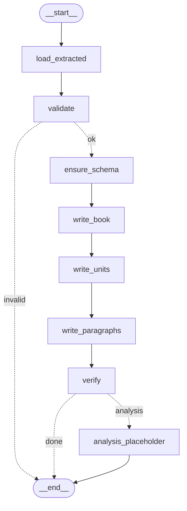

# Ingest base: LangGraph + Neo4j

Phase A (`pov extract`) đã biến một cuốn sách thành file. Tài liệu này mô tả **base cho giai đoạn
ingest**: đọc các file đó và ghi vào **Neo4j** bằng một **LangGraph** nhỏ, xác định (deterministic),
**không dùng LLM**. Bạn sẽ viết các bước phân tích (B1, B2, ...) lên trên base này.

Chỉ có hai thứ ở đây: LangGraph và Neo4j. Không Postgres, không SQLAlchemy, không Alembic.

## 1. Chạy nhanh

```bash
# 1. Đặt mật khẩu Neo4j (>= 8 ký tự) vào file bí mật. Không bao giờ commit hay in nó ra.
echo 'NEO4J_PASSWORD=<mật-khẩu-của-bạn>' >> ~/.config/book-clone/secrets.env

# 2. Bật Neo4j (docker compose, project "book-clone-dev"), chờ healthcheck xanh
make neo4j-up

# 3. Trích xuất sách (phase A), rồi nạp vào Neo4j (phase ingest)
uv run pov extract ~/.local/share/book-clone/books/lww.html
uv run pov ingest the-lion-the-witch-and-the-wardrobe        # hoặc: make ingest BOOK=the-lion-...

# 4. Xem
uv run pov neo4j-status        # Neo4j sống không, đang có sách nào
uv run pov graph               # sơ đồ Mermaid của LangGraph
open http://localhost:7475     # Neo4j Browser (user: neo4j, password: NEO4J_PASSWORD)
make neo4j-shell               # cypher-shell trong container
make neo4j-down
```

Kết quả thật khi nạp LWW:

```text
  > load_extracted
  ok  load_extracted       0.00s
  > validate
  ok  validate             0.00s  ok
  ...
  ok  write_units          0.17s  units=17
  ok  write_paragraphs     0.28s  paragraphs=822
  ok  verify               0.05s  ok

Ingested the-lion-the-witch-and-the-wardrobe: {'books': 1, 'units': 17, 'paragraphs': 822}
```

**Lưu ý:** `pov ingest` đọc từ `BOOK_CLONE_DATA_DIR/extracted/<book_id>/` (nơi `pov extract` ghi mặc
định), nên đừng dùng `--out` khi extract một cuốn mà bạn định nạp.

**Cổng.** Stack `book-clone` đang chạy chiếm `7474` và `7687`, nên stack này dùng
**`7475` (Browser)** và **`7688` (Bolt)**. Hai số đó nằm ở `NEO4J_HTTP_PORT`, `NEO4J_BOLT_PORT`
(`src/pov_retell/config.py`, `docker/compose.yml`, `.env.example`). Đổi chúng ở `secrets.env` nếu cần.
Khi Browser hỏi địa chỉ kết nối, nhập `bolt://localhost:7688`.

**Các lệnh:**

| Lệnh | Việc |
|---|---|
| `pov ingest <book_id>` | chạy graph, in một dòng cho mỗi node |
| `pov ingest <book_id> --checkpoint sqlite` | lưu checkpoint vào file để chạy lại được khi crash |
| `pov ingest <book_id> --resume --checkpoint sqlite` | tiếp tục lần chạy dở, từ node bị lỗi |
| `pov ingest <book_id> --replace` | xóa unit/paragraph cũ của sách rồi ghi lại (sau khi extract lại bằng `--map llm`, chẳng hạn) |
| `pov ingest <book_id> --analysis` | bật nhánh `analysis_placeholder` (chưa làm gì, xem mục 6) |
| `pov graph` / `pov neo4j-status` | sơ đồ / kiểm tra kết nối |
| `make test-neo4j` | test tích hợp với Neo4j thật (opt-in, ghi rồi xóa một sách tạm) |

## 2. Bản đồ file

| File | Việc |
|---|---|
| `src/pov_retell/ingest_graph.py` | **đọc đầu tiên**: `IngestState`, các node, các edge, chạy và stream sự kiện |
| `src/pov_retell/neo4j_store.py` | mọi thứ nói chuyện với Neo4j: driver, healthcheck, schema, ghi bằng MERGE |
| `src/pov_retell/config.py` | `NEO4J_*` (cổng, user, password dạng `SecretStr`), `checkpoint_db` |
| `src/pov_retell/cli.py` | `ingest`, `graph`, `neo4j-status` |
| `docker/compose.yml`, `Makefile` | Neo4j 5 community, `neo4j-up/down/shell`, `ingest` |
| `tests/test_ingest_graph.py`, `tests/fake_writer.py` | test graph với writer giả trong bộ nhớ |
| `tests/test_neo4j_integration.py` | test thật với Neo4j (opt-in) |

## 3. LangGraph, giải thích bằng chính code này

Đây là sơ đồ của graph (`uv run pov graph`; dán vào <https://mermaid.live> để xem):



Đường nét liền là **edge** thường, đường nét đứt là **conditional edge**.

### State

`IngestState` (`ingest_graph.py`) là một `TypedDict`: **bộ nhớ chung** mà mọi node đọc và cập nhật.

```python
class IngestState(TypedDict, total=False):
    book_id: str       # input
    replace: bool      # input
    analysis: bool     # input
    extracted: dict    # book.json dạng dữ liệu thường, do load_extracted điền
    errors: list[str]  # vấn đề tìm thấy; danh sách không rỗng thì dừng
    written: dict      # số dòng mỗi node ghi vào Neo4j
```

Hai điều cần nhớ:

- Một node **chỉ trả về các key nó đổi**, không trả lại cả state. LangGraph trộn phần đó vào state.
- Mặc định mỗi key **bị ghi đè** (không cộng dồn). Vì vậy `write_units` phải tự trộn:
  `{"written": {**state["written"], "units": n}}`. Muốn cộng dồn tự động thì khai báo *reducer*
  (`Annotated[list, operator.add]`); ở đây không cần.
- State chứa **dữ liệu thường** (dict, list), không phải model Pydantic, để checkpointer lưu và nạp lại
  được mà không phải đăng ký kiểu.

### Node

Node là một hàm `(state) -> phần state đổi`. Mỗi node ở đây làm **một việc nhỏ**, đặt tên rõ:

| Node | Việc |
|---|---|
| `load_extracted` | đọc `extracted/<book_id>/book.json` |
| `validate` | `schema_version`, kiểu dữ liệu (bằng model của phase A), id không trùng, cha là part, đoạn thuộc chapter |
| `ensure_schema` | tạo constraint trong Neo4j (`IF NOT EXISTS`) |
| `write_book` | `MERGE` node `Book`; từ chối nếu id này đang giữ một file khác (trừ khi `--replace`) |
| `write_units` | node `Unit` + cạnh `HAS_UNIT`, `NEXT`, `CONTAINS` |
| `write_paragraphs` | node `Paragraph` + cạnh `HAS_PARAGRAPH`, `NEXT` |
| `verify` | đếm trong Neo4j, so với số tính từ `book.json` |
| `analysis_placeholder` | chỗ cắm mở rộng, mặc định tắt |

Các node là **closure** bên trong `build_graph(writer, ...)`: nhờ vậy chúng dùng được `writer` mà không
cần biến toàn cục, và test thay `writer` bằng bản giả. Graph chỉ biết `GraphWriter` (một `Protocol`),
không bao giờ import driver Neo4j.

### Edge và conditional edge

```python
graph.add_edge("write_book", "write_units")                       # luôn đi từ write_book sang write_units
graph.add_conditional_edges("validate", after_validate,           # hàm quyết định...
                            {"ok": "ensure_schema", "invalid": END})   # ...và bảng nhãn -> node
```

`after_validate(state)` trả về `"ok"` hoặc `"invalid"`; LangGraph tra bảng để biết đi đâu. Có hai nơi
rẽ nhánh: sau `validate` (file hỏng thì dừng, **chưa ghi gì**) và sau `verify` (có `--analysis` thì
sang `analysis_placeholder`, không thì kết thúc). `START` và `END` là hai node đặc biệt.

### Compile, checkpointer, thread_id

`graph.compile(checkpointer=...)` biến định nghĩa thành đối tượng chạy được (`.stream`, `.invoke`,
`.get_state`, `.get_graph()`). **Checkpointer** lưu state **sau mỗi node**:

| Checkpointer | Lưu ở | Dùng khi |
|---|---|---|
| `InMemorySaver` (tên cũ `MemorySaver`), **mặc định** | RAM | chạy một mạch; mất khi process thoát |
| `SqliteSaver`, `--checkpoint sqlite` | `BOOK_CLONE_DATA_DIR/checkpoints.sqlite` | muốn `--resume` sau crash |

`thread_id` là **tên của một lần chạy** (`ingest-<book_id>` trong `thread_config`): cùng `thread_id` thì
cùng chuỗi checkpoint. Truyền `config` vào mọi lời gọi; `graph.get_state(config)` cho biết state hiện tại
và `.next` (các node chưa chạy).

> File checkpoint khá nặng (khoảng 4 MB cho Treasure Island) vì state giữ cả `book.json`. Nếu bạn thấy
> phiền, đổi `extracted` thành đường dẫn và để mỗi node tự đọc lại file.

### Streaming

`stream_events(graph, input, config)` chạy graph bằng `stream_mode="debug"`: mỗi node cho một sự kiện
`task` (bắt đầu) và `task_result` (xong), **kèm timestamp**, từ đó tính thời gian. `cli.py` in ra:
`ok  write_units  0.17s  units=17`. Node lỗi cho dòng `ERR` rồi lỗi được ném tiếp. Các `stream_mode`
khác: `updates` (phần state mỗi node đổi), `values` (toàn bộ state sau mỗi node), `custom`.

### Resume sau crash

Vì state được lưu sau mỗi node, một lần chạy chết giữa chừng có thể đi tiếp. Mô phỏng thật (một
`write_paragraphs` bị ném lỗi, Neo4j đã có 40 unit nhưng 0 paragraph):

```text
ok write_units units=40
error write_paragraphs OSError: simulated crash: the machine lost power
next node to run: ('write_paragraphs',)
$ uv run pov ingest treasure-island --resume --checkpoint sqlite
  > write_paragraphs
  ok  write_paragraphs     0.32s  paragraphs=1382
  ok  verify               0.04s  ok
```

`--resume` gọi `graph.stream(None, config)`: **`None` nghĩa là "tiếp tục từ checkpoint"**. Chỉ các node
chưa xong chạy lại. Một node **đang dở** có thể chạy lại từ đầu, nên mọi node ghi phải **idempotent**,
và đó là lý do ta dùng `MERGE` (mục 4).

### Interrupt (chưa dùng, nhưng đây là chỗ nó thuộc về)

`interrupt` tạm dừng graph để chờ người, rồi chạy tiếp từ đúng chỗ đó (cần checkpointer). Bước A2d của
thiết kế ("bạn xác nhận bản đồ cấu trúc") là ví dụ tự nhiên. Đoạn này đã được chạy thử với LangGraph
1.2.15:

```python
from langgraph.types import Command, interrupt

def confirm(state: IngestState) -> IngestState:
    n = len(state["extracted"]["units"])
    answer = interrupt({"question": f"Write {n} units to Neo4j?"})   # <- chạy dừng ở đây
    return {} if answer else {"errors": ["cancelled by the human"]}

# graph.add_node("confirm", confirm); validate --ok--> confirm --> ensure_schema
# lần 1: graph.stream(input, config)               -> sự kiện "__interrupt__" mang câu hỏi
# lần 2: graph.stream(Command(resume=True), config) -> confirm nhận answer=True và chạy tiếp
```

## 4. Mô hình Neo4j

```text
(:Book {id}) -[:HAS_UNIT]-> (:Unit {book_id, id}) -[:HAS_PARAGRAPH]-> (:Paragraph {book_id, id})

(:Unit)-[:NEXT]->(:Unit)             các chapter theo thứ tự đọc (part không nằm trong chuỗi này)
(:Unit {kind:'part'})-[:CONTAINS]->(:Unit)   part chứa chapter của nó (chỉ khi sách có part)
(:Paragraph)-[:NEXT]->(:Paragraph)   các đoạn trong cùng một unit, theo thứ tự
```

| Node | Thuộc tính |
|---|---|
| `Book` | `id`, `title`, `author`, `format`, `sha256`, `source`, `map_method`, `schema_version` |
| `Unit` | `book_id`, `id` (`u04`), `order`, `kind` (`chapter`, `part`, ...), `title`, `parent_id`, `char_start`, `char_end` |
| `Paragraph` | `book_id`, `id` (`u04_p041`), `unit_id`, `order`, **`text`**, `char_start`, `char_end`, `flags` |

Các quyết định thiết kế, và lý do:

- **Văn bản nằm trên node `Paragraph`** (`text`), để các bước phân tích đọc thẳng từ Neo4j.
  `canonical.txt`, `candidates` và `map_items` **không** được nạp: chúng là dữ liệu làm việc của phase A
  và vẫn nằm trong `book.json`. `char_start/char_end` vẫn là vị trí trong `canonical.txt`.
- **`NEXT` giữa unit chỉ nối các chapter** (chapter, letter, section), vì nút NEXT của sản phẩm đi từ
  chương này sang chương kia. Part chỉ có tiêu đề nên được nối bằng `CONTAINS`. Muốn nối cả part, sửa
  một dòng trong `unit_edges` (`ingest_graph.py`).
- **`NEXT` giữa paragraph chạy trong một unit** và bắt đầu lại ở unit sau. Muốn một chuỗi xuyên cả cuốn,
  sửa `paragraph_edges`.
- **Khóa là `(book_id, id)`**, không chỉ `id`, vì `u02` tồn tại trong mọi cuốn. Constraint:
  `Book(id)`, `Unit(book_id, id)`, `Paragraph(book_id, id)` đều UNIQUE (cũng tạo index cho MERGE).
  Community edition **không** có `NODE KEY`, nhưng uniqueness nhiều thuộc tính thì có.
- **MERGE, không CREATE**: `MERGE (u:Unit {book_id, id}) SET u += row` nên chạy lại không sinh trùng
  (cả node lẫn cạnh). Đó là điều làm cho resume và chạy lại an toàn.
- **`UNWIND $rows`**: một câu lệnh cho 500 dòng thay vì 500 câu lệnh; 822 paragraph của LWW ghi trong
  chưa đầy một giây.
- **`verify`** so 7 con số (`units`, `paragraphs`, `has_unit`, `has_paragraph`, `unit_next`,
  `contains`, `paragraph_next`) giữa Neo4j và `book.json`. Nó bắt được trường hợp còn dòng cũ của một
  lần extract trước (khi đó dùng `--replace`).
- **Một file khác dưới cùng `book_id`** bị từ chối (so `sha256`), giống phase A.

## 5. Mười câu Cypher để khám phá

Mở <http://localhost:7475>, đăng nhập `neo4j` + `NEO4J_PASSWORD`. Đặt tham số **một lần**:

```cypher
:param bookId => 'the-lion-the-witch-and-the-wardrobe'
```

Mọi câu dưới đây đã được chạy thật trên LWW (câu 7 trên Treasure Island, vì LWW không có part). Với
Treasure Island, chương đầu là `u02` (`u01` là Part One).

**1. Cuốn sách**
```cypher
MATCH (b:Book {id: $bookId})
RETURN b.title, b.author, b.format, b.map_method, left(b.sha256, 12) AS sha
```

**2. Hình dạng của graph** (bấm vào chế độ đồ thị để thấy Book, Unit, Paragraph và các quan hệ)
```cypher
CALL db.schema.visualization()
```

**3. Mục lục: số đoạn và số từ của mỗi unit**
```cypher
MATCH (b:Book {id: $bookId})-[:HAS_UNIT]->(u:Unit)
OPTIONAL MATCH (u)-[:HAS_PARAGRAPH]->(p)
RETURN u.order AS n, u.id AS id, u.kind AS kind, u.title AS title,
       count(p) AS paragraphs, sum(size(split(p.text, ' '))) AS words
ORDER BY n
```

**4. Đọc chương 1** (8 đoạn đầu)
```cypher
MATCH (:Unit {book_id: $bookId, id: 'u01'})-[:HAS_PARAGRAPH]->(p)
RETURN p.id, left(p.text, 120) AS text ORDER BY p.order LIMIT 8
```

**5. Chương kế tiếp** (đi theo `NEXT`)
```cypher
MATCH (a:Unit {book_id: $bookId, id: 'u01'})-[:NEXT]->(n:Unit)
RETURN a.title AS from, n.title AS next
```

**6. Đường đi qua bốn chương đầu** (chế độ đồ thị: một chuỗi nối tiếp)
```cypher
MATCH path = (:Unit {book_id: $bookId, id: 'u01'})-[:NEXT*0..3]->(:Unit)
RETURN path
```

**7. Part chứa những chapter nào** (chỉ sách có part, ví dụ Treasure Island)
```cypher
:param bookId => 'treasure-island'
MATCH (p:Unit {book_id: $bookId, kind: 'part'})-[:CONTAINS]->(c:Unit)
RETURN p.order AS n, p.title AS part, count(c) AS chapters ORDER BY n
```
(6, 6, 3, 6, 6 và 7 chapter, tổng 34.)

**8. Một đoạn và hai đoạn kề nó** (ngữ cảnh)
```cypher
MATCH (prev)-[:NEXT]->(p:Paragraph {book_id: $bookId, id: 'u01_p010'})-[:NEXT]->(next)
RETURN left(prev.text, 60) AS prev, left(p.text, 60) AS paragraph, left(next.text, 60) AS next
```

**9. Một từ xuất hiện nhiều nhất ở chương nào** (tìm kiếm văn bản thô, chưa phải phân tích)
```cypher
MATCH (p:Paragraph {book_id: $bookId}) WHERE toLower(p.text) CONTAINS 'aslan'
RETURN p.unit_id AS unit, count(*) AS paragraphs ORDER BY paragraphs DESC LIMIT 5
```

**10. Các đoạn bị gắn cờ ở phase A**
```cypher
MATCH (p:Paragraph {book_id: $bookId}) WHERE size(p.flags) > 0
RETURN p.id, p.flags, p.text
```

Kiểm tra nhanh (phải ra 0): đoạn mồ côi không thuộc unit nào.
```cypher
MATCH (p:Paragraph {book_id: $bookId}) WHERE NOT (:Unit)-[:HAS_PARAGRAPH]->(p) RETURN count(p)
```

## 6. Thêm node tiếp theo (ví dụ B1 mentions)

`analysis_placeholder` là **điểm mở rộng duy nhất** (có chú thích `EXTENSION POINT` trong code). Một bước
phân tích mới luôn là **hai việc**: một node *tính* (gọi LLM, thuần túy, thử lại được) và một node *ghi*
(MERGE vào Neo4j, idempotent). Ví dụ B1 (tìm tên gọi nhân vật trong từng đoạn). Năm thay đổi:

**1. Thêm khóa vào state** (`IngestState`):
```python
mentions: list[dict[str, Any]]   # [{"id", "paragraph_id", "text"}], do b1_mentions điền
```

**2. Thêm phương thức ghi vào `GraphWriter` và `Neo4jWriter`**, cộng một constraint trong `SCHEMA`:
```python
# neo4j_store.py, SCHEMA:
"CREATE CONSTRAINT mention_key IF NOT EXISTS FOR (m:Mention) REQUIRE (m.book_id, m.id) IS UNIQUE",

# Neo4jWriter:
def write_mentions(self, book_id: str, rows: list[dict[str, Any]]) -> None:
    for batch in _batches(rows):
        self._run(
            "UNWIND $rows AS row "
            "MATCH (p:Paragraph {book_id: $book_id, id: row.paragraph_id}) "
            "MERGE (m:Mention {book_id: $book_id, id: row.id}) SET m += row "
            "MERGE (p)-[:HAS_MENTION]->(m)",
            book_id=book_id, rows=batch,
        )
```
(thêm cùng chữ ký vào `GraphWriter` và `FakeWriter` để test chạy được).

**3. Viết hai node** bên trong `build_graph`, cạnh `analysis_placeholder`:
```python
def b1_mentions(state: IngestState) -> IngestState:
    """LLM đề xuất, code kiểm: LLM trả chuỗi trích nguyên văn, code tìm lại trong đoạn."""
    rows = []
    for p in state["extracted"]["paragraphs"]:
        # ở đây gọi llm.complete_json(prompt, MentionsResponse, check) cho từng đoạn
        for i, name in enumerate(find_names(p["text"])):
            rows.append({"id": f"{p['id']}_m{i + 1}", "paragraph_id": p["id"], "text": name})
    return {"mentions": rows}

def write_mentions(state: IngestState) -> IngestState:
    writer.write_mentions(state["book_id"], state["mentions"])
    return {"written": {**state["written"], "mentions": len(state["mentions"])}}
```

**4. Đăng ký và nối edge**: thay dòng `graph.add_edge("analysis_placeholder", END)` bằng
```python
for node in (b1_mentions, write_mentions):
    graph.add_node(node.__name__, node)
graph.add_edge("analysis_placeholder", "b1_mentions")
graph.add_edge("b1_mentions", "write_mentions")
graph.add_edge("write_mentions", END)
```
Vì nhánh `verify -> analysis_placeholder` chỉ mở khi có `--analysis`, **ingest thường không đổi**.
Muốn chạy B1 mặc định thì bỏ điều kiện trong `after_verify`.

**5. Test**: chạy graph với `FakeWriter` đã có `write_mentions` (xem `tests/test_ingest_graph.py`,
`run(writer, dir, analysis=True)`), rồi `pov ingest <book> --analysis` và hỏi Neo4j:
`MATCH (p:Paragraph)-[:HAS_MENTION]->(m) RETURN p.id, m.text LIMIT 10`.

Vài lưu ý khi viết bước phân tích:

- Node tính và node ghi tách rời nên **resume không gọi lại LLM** (và không tốn tiền lần nữa) nếu chỉ
  node ghi bị lỗi: kết quả của `b1_mentions` đã nằm trong checkpoint.
- Mỗi lần chạy phân tích nên mang một `run_id` (nguyên tắc 7 của thiết kế: snapshot bất biến, chỉ ghi
  thêm). Hãy đặt nó vào state và vào khóa của node mới, ví dụ `Mention {book_id, run_id, id}`.
- `llm.py` (JSON mode, Pydantic, thử lại tối đa 2 lần kèm lỗi, thinking luôn tắt) dùng lại nguyên.

## 7. Khi có sự cố

| Triệu chứng | Nguyên nhân và cách xử lý |
|---|---|
| `NEO4J_PASSWORD is not set` | thêm vào `~/.config/book-clone/secrets.env` rồi `make neo4j-up` |
| `cannot reach Neo4j` | `make neo4j-up`; kiểm tra cổng `7688` có bị chiếm không (`docker ps`) |
| `Neo4j refused the request` | mật khẩu trong secrets khác mật khẩu lúc volume được tạo; `make neo4j-down`, xóa volume `book-clone-dev_neo4j_data` rồi `make neo4j-up` |
| `... does not exist: run pov extract first` | chưa có `extracted/<book_id>/book.json` |
| `already holds book ... from a different file` | id này đang giữ file khác trong Neo4j; dùng `--replace` hoặc đổi `--id` lúc extract |
| `verify` báo lệch số đếm | còn dòng cũ của lần extract trước; chạy lại với `--replace` |
| `nothing to resume` | không có lần chạy dở; chạy lại không kèm `--resume` |
